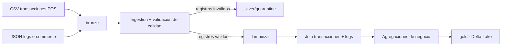

# BIG-DATA · Pipeline batch de DATAMARCA S.A.

Pipeline de procesamiento batch con **PySpark** que ingiere transacciones de puntos de venta (CSV) y eventos de e-commerce (JSON), valida su calidad, los limpia, los cruza y genera KPIs de negocio.

Puede ejecutarse de dos formas con el mismo código:

| Modo | Entrada | Salida | Cuándo usarlo |
|---|---|---|---|
| **Local** (por defecto) | `data/raw/` | `data/processed/` (Parquet) | Desarrollo y pruebas en el computador |
| **Azure** | ADLS Gen2, contenedor `bronze` | ADLS Gen2, `silver` y `gold` (Delta Lake) | Ejecución en la nube con Databricks |

El modo se elige con la variable de entorno `DATAMARCA_STORAGE`: si no existe, corre en local; si contiene el nombre de la cuenta de almacenamiento, corre en Azure (ver `src/config/rutas.py`).

---

## Arquitectura



Se sigue una arquitectura **Medallion** sobre ADLS Gen2. La estrategia de particionamiento (por `fecha`) está en [`docs/particionamiento.md`](docs/particionamiento.md).

### Resultados generados (capa gold)

`kpis_negocio_categoria`, `kpis_por_categoria`, `ventas_por_dia`, `top_clientes`, `ventas_por_tienda` y `ventas_por_metodo_pago`.

---

## Estructura del repositorio

```
.
├── azure/
│   ├── infrastructure/     Terraform: grupo de recursos, ADLS Gen2, Databricks
│   └── databricks-jobs/    Definición del job que ejecuta el pipeline
├── data/
│   ├── raw/                Datos de entrada de ejemplo (CSV y JSON)
│   └── processed/          Resultados del modo local
├── docs/                   Reglas de calidad, particionamiento, batch vs streaming, política Git
├── notebooks/              Análisis exploratorio (EDA)
├── reports/                Evidencias de tiempos y de optimización (Catalyst)
├── src/
│   ├── main.py             Orquestador del pipeline
│   ├── config/             Esquemas estrictos y rutas (local / Azure)
│   ├── ingestion/          Lectura y validación de calidad
│   ├── transformations/    Limpieza, joins y agregaciones
│   ├── optimization/       Benchmarks y análisis del optimizador Catalyst
│   └── utils/              Registro de tiempos por etapa
└── tests/                  Pruebas con pytest sobre Spark local
```

---

## Ejecución local

**Requisitos:** Python 3.12 y Java 17 o 21 (PySpark 3.5 no soporta Python 3.14).

```bash
py -3.12 -m venv .venv
.venv\Scripts\activate
pip install -r tests/requirements-test.txt
python src/main.py
```

Ejecútalo desde la **raíz** del repositorio. Los resultados quedan en `data/processed/`, la cuarentena y las métricas de calidad en `data/quarantine/` y los tiempos por etapa en `reports/tiempos/`.

### Pruebas

```bash
pytest tests -v
```

Las pruebas generan sus propios datos pequeños y no leen `data/raw/`. Más detalles en [`tests/README.md`](tests/README.md).

---

## Variables de entorno y credenciales

Ninguna variable ni credencial se versiona. Los valores se definen en cada entorno.

| Variable / credencial | Dónde se define | Obligatoria | Para qué sirve |
|---|---|---|---|
| `DATAMARCA_STORAGE` | Entorno del proceso o del cluster | Solo en Azure | Nombre de la cuenta ADLS Gen2. Si existe, el pipeline lee de `bronze` y escribe en `silver`/`gold`. Si no existe, corre en local |
| `SHUFFLE_PARTITIONS` | Entorno del proceso o del cluster | No | Número de particiones de shuffle de Spark (`spark.sql.shuffle.partitions`). Por defecto, el de Spark (200). Se usa en las pruebas de rendimiento |
| `subscription_id` | `azure/infrastructure/terraform.tfvars` | Para Terraform | ID de la suscripción de Azure |
| `location` | `azure/infrastructure/terraform.tfvars` | No | Región de Azure (`mexicocentral`) |
| Clave de la cuenta de almacenamiento | Secret scope `datamarca`, secreto `storage-key` | Para Databricks | Acceso del cluster a ADLS Gen2. El cluster la lee con `{{secrets/datamarca/storage-key}}` |
| Inicio de sesión de Azure y Databricks | `az login` y `databricks auth login` | Para el despliegue | Autenticación de las CLI |

## Reproducir la ejecución en un entorno limpio

**Local** (desde la raíz del repositorio, con Python 3.12 y Java 17 o 21):

```bash
py -3.12 -m venv .venv
.venv\Scripts\activate
pip install -r tests/requirements-test.txt
python src/main.py
```

**Azure** (desde cero; el detalle de cada paso está en la sección siguiente):

```powershell
# 1. Infraestructura
cd azure\infrastructure
terraform init; terraform apply
# 2. Datos, acceso al storage, código y job: pasos 2 a 4
# 3. Ejecución
databricks jobs run-now <job_id>
```

---

## Despliegue en Azure

### Requisitos previos

- Suscripción de Azure (por ejemplo, Azure for Students).
- [Azure CLI](https://learn.microsoft.com/cli/azure/install-azure-cli), [Terraform](https://developer.hashicorp.com/terraform/install) y [Databricks CLI](https://docs.databricks.com/dev-tools/cli/) instalados.
- Sesión iniciada con `az login`.
- Proveedores registrados en la suscripción:

```bash
az provider register --namespace Microsoft.Storage
az provider register --namespace Microsoft.Databricks
az provider register --namespace Microsoft.Compute
az provider register --namespace Microsoft.Network
az provider register --namespace Microsoft.ManagedIdentity
```

### 1. Crear la infraestructura

En `azure/infrastructure/` crea el archivo `terraform.tfvars` (está en `.gitignore`, no se sube):

```hcl
subscription_id = "<id-de-tu-suscripcion>"
location        = "<region-permitida>"   # opcional, por defecto eastus2
```

El ID se obtiene con `az account show --query id -o tsv`. Las suscripciones de estudiante solo permiten ciertas regiones; si Terraform responde `RequestDisallowedByAzure`, cambia `location`.

```bash
terraform init
terraform plan
terraform apply
```

Se crean: un grupo de recursos, una cuenta ADLS Gen2 con los contenedores `bronze`, `silver` y `gold`, y un workspace de Azure Databricks (SKU `premium`, el SKU `standard` ya no se acepta).

### 2. Subir los datos crudos

```powershell
$cuenta = terraform output -raw storage_account_name
az storage blob upload-batch --account-name $cuenta --destination bronze --source ..\..\data\raw --auth-mode key
```

### 3. Configurar el acceso de Databricks al storage

Guarda la clave de la cuenta en un secret scope (nunca en el código ni en Git):

```powershell
databricks auth login --host (terraform output -raw databricks_url)
$clave = az storage account keys list --account-name $cuenta --resource-group rg-datamarca-dev --query "[0].value" -o tsv
databricks secrets create-scope datamarca
databricks secrets put-secret datamarca storage-key --string-value $clave
```

En el cluster (**Compute → Edit → Advanced options**):

- **Spark config:**
  ```
  spark.hadoop.fs.azure.account.key.<cuenta>.dfs.core.windows.net {{secrets/datamarca/storage-key}}
  ```
- **Environment variables:**
  ```
  DATAMARCA_STORAGE=<cuenta>
  ```

Reinicia el cluster después de guardar.

### 4. Subir el código y crear el job

Desde la raíz del repositorio:

```powershell
$email = (databricks current-user me --output json | ConvertFrom-Json).userName
databricks workspace import-dir src "/Workspace/Users/$email/BIG-DATA/src" --overwrite

# Rellena la plantilla del job con tu cluster y tu usuario
$clusterId = "<id-del-cluster>"
(Get-Content azure\databricks-jobs\job_pipeline.json -Raw) -replace "__CLUSTER_ID__", $clusterId -replace "__EMAIL__", $email | Set-Content job_listo.json
databricks jobs create --json "@job_listo.json"
```

`job_listo.json` contiene datos de tu entorno: bórralo y no lo subas a Git.

### 5. Ejecutar y verificar

```powershell
databricks jobs run-now <job_id>
az storage blob list --account-name $cuenta --container-name gold --auth-mode key --query "[].name" -o tsv
```

En `gold` deben aparecer las carpetas Delta de los resultados y en `silver/quarantine` la cuarentena de la validación.

### 6. Evidencia de la ejecución (tiempos por etapa)

En cada corrida en Azure, `main.py` publica el log de tiempos en el Data Lake, porque el disco del driver de Databricks se pierde al apagar el cluster:

```
gold/reports/tiempos/json/tiempos_<AAAAMMDD_HHMMSS>/part-*.txt   detalle de la corrida (JSON)
gold/reports/tiempos/csv/tiempos_<AAAAMMDD_HHMMSS>/part-*.txt    una fila por subetapa (CSV)
```

El JSON incluye tiempo total, tiempo por etapa (ingestión, transformación, persistencia), filas, estado y el entorno (versiones de Python y Spark). Para guardarlo como evidencia en el repositorio:

```powershell
az storage blob download-batch --account-name $cuenta --source gold --pattern "reports/tiempos/*part-*" --destination .\tmp_tiempos --auth-mode key
New-Item -ItemType Directory -Force reports\tiempos\evidencia\azure | Out-Null
Get-ChildItem .\tmp_tiempos -Recurse -Filter "part-*" | ForEach-Object {
    Copy-Item $_.FullName "reports\tiempos\evidencia\azure\$($_.Directory.Name).$($_.Directory.Parent.Name)"
}
Remove-Item .\tmp_tiempos -Recurse
```

Quedan archivos como `reports/tiempos/evidencia/azure/tiempos_<id>.json` y `.csv`. La salida completa del job (calidad de datos, tabla de tiempos y `PIPELINE COMPLETADO`) se puede ver en la corrida, dentro de **Jobs & Pipelines** en Databricks.

### Supuestos del entorno cloud

- Proveedor: Microsoft Azure, suscripción Azure for Students (regiones restringidas por política).
- Almacenamiento: ADLS Gen2 (cuenta `StorageV2` con namespace jerárquico, LRS) con los contenedores `bronze`, `silver` y `gold`.
- Cómputo: Azure Databricks, workspace SKU `premium`, cluster de acceso compartido (Spark Connect) con auto-apagado. Versión de Databricks Runtime: `<completar>`.
- Formato de salida: Delta Lake en `gold`; la cuarentena de calidad se guarda en Parquet en `silver/quarantine`.
- Autenticación al storage: clave de la cuenta en un secret scope (adecuado para desarrollo).
- Volumen de la prueba: 5.000 transacciones y 5.000 eventos de e-commerce.
- El pipeline no mantiene estado entre corridas: cada ejecución sobrescribe sus resultados.

### Costos y limpieza

- El workspace y el almacenamiento cuestan poco; el gasto principal es el **cluster de Databricks**. Activa el auto-apagado y termínalo al acabar.
- Para eliminar todo lo creado (**incluidos los datos**): `terraform destroy` en `azure/infrastructure/`.

### Notas de seguridad

- Nunca versiones `terraform.tfvars`, `*.tfstate`, claves, tokens ni archivos `.env`. Antes de cada commit revisa `git status`.
- La clave de cuenta en un secret scope sirve para desarrollo. Para producción es preferible usar identidades administradas o Unity Catalog.
- En clusters de acceso compartido no está disponible `spark.sparkContext`; el código ya lo tiene en cuenta.

---

## Calidad de datos

Cada fuente se lee con **esquema estricto** (sin `inferSchema`) y se valida con reglas documentadas en [`docs/reglas_calidad.md`](docs/reglas_calidad.md). Los registros que incumplen reglas críticas se envían a **cuarentena** con el ID de la regla, y cada ejecución guarda métricas de calidad. Las advertencias no rechazan registros.

## Rendimiento y optimización

- **Tiempos por etapa:** cada ejecución registra duración y filas por subetapa. En local se guardan en `reports/tiempos/`; en Azure, en `gold/reports/tiempos/` (ver paso 6). Evidencias en `reports/tiempos/evidencia/` y detalle en [`reports/tiempos/README.md`](reports/tiempos/README.md).
- **Optimizador Catalyst:** los análisis y benchmarks (column pruning, predicate pushdown, funciones nativas vs UDF de Python, joins) están en `src/optimization/` y sus evidencias en `reports/optimizacion/`.

## Documentación

| Documento | Contenido |
|---|---|
| [`docs/reglas_calidad.md`](docs/reglas_calidad.md) | Reglas de validación de datos |
| [`docs/particionamiento.md`](docs/particionamiento.md) | Estrategia de particionamiento y capas Medallion |
| [`docs/Justificacion_batch_vs_streaming.md`](docs/Justificacion_batch_vs_streaming.md) | Por qué se eligió procesamiento batch |
| [`docs/politica_git.md`](docs/politica_git.md) | Ramas, commits semánticos y revisión |

## Flujo de trabajo en Git

Se trabaja en ramas propias y se integra a `main` mediante pull request (plantilla en `.github/pull_request_template.md`). Los commits siguen el formato semántico descrito en [`docs/politica_git.md`](docs/politica_git.md), por ejemplo `feat(azure): ...`.

## Pendientes

- Workflow de GitHub Actions en `.github/workflows/` (tests y despliegue automático).
- Particionado por `fecha` al escribir en Delta (definido en `docs/particionamiento.md`, aún sin aplicar en el código).
