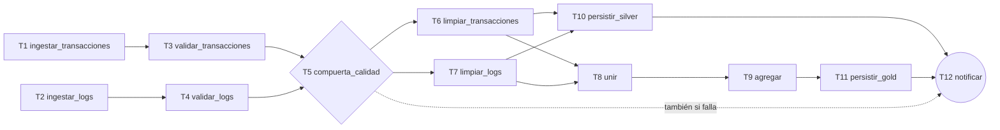

# Dependencias entre tareas del pipeline (Unidad 4, paso 1)

Proyecto Spark Pipeline - DATAMARCA S.A.

Este documento baja las cinco etapas de `docs/orquestacion/etapas.md` a tareas concretas e identifica de qué depende cada una. Es la base para el DAG del paso 2. Sigue siendo neutro respecto a la herramienta (Airflow o Step Functions).

## 1. Tareas

Se proponen 12 tareas, con ingestión y validación separadas por fuente para que transacciones y logs avancen en paralelo.

| Id | Etapa | Tarea | Código de la Unidad 3 |
|---|---|---|---|
| T1 | Ingestión | `ingestar_transacciones` | `leer_transacciones_csv_crudo` |
| T2 | Ingestión | `ingestar_logs` | `leer_logs_ecommerce_json_crudo` |
| T3 | Validación | `validar_transacciones` | `validar_transacciones` + `guardar_resultado_validacion` |
| T4 | Validación | `validar_logs` | `validar_logs` + `guardar_resultado_validacion` |
| T5 | Validación | `compuerta_calidad` | Nueva. Revisa las métricas de T3 y T4 |
| T6 | Transformación | `limpiar_transacciones` | `ejecutar_limpieza_transacciones` |
| T7 | Transformación | `limpiar_logs` | `ejecutar_limpieza_logs` |
| T8 | Transformación | `unir` | `realizar_join_transacciones_logs` |
| T9 | Transformación | `agregar` | `generar_agregaciones_negocio` + `ejecutar_agregaciones` |
| T10 | Persistencia | `persistir_silver` | `persistir_silver` |
| T11 | Persistencia | `persistir_gold` | `persistir_gold` |
| T12 | Notificación | `notificar` | Nueva |

`compuerta_calidad` (T5) es una tarea de control: no transforma datos, solo decide si la corrida continúa (sección 4).

## 2. Dependencias

"Datos" significa que la tarea consume algo que produjo la anterior. "Control" significa que solo espera su resultado o su estado.

| Tarea | Depende de | Tipo | Qué consume | Regla de disparo |
|---|---|---|---|---|
| T1 `ingestar_transacciones` | (ninguna) | - | CSV de origen | - |
| T2 `ingestar_logs` | (ninguna) | - | JSON de origen | - |
| T3 `validar_transacciones` | T1 | Datos | Transacciones crudas | Todas las anteriores con éxito |
| T4 `validar_logs` | T2 | Datos | Logs crudos | Todas las anteriores con éxito |
| T5 `compuerta_calidad` | T3, T4 | Control | Métricas de rechazo de ambas fuentes | Todas las anteriores con éxito |
| T6 `limpiar_transacciones` | T5 (y datos de T3) | Datos + control | Transacciones válidas | Todas las anteriores con éxito |
| T7 `limpiar_logs` | T5 (y datos de T4) | Datos + control | Logs válidos | Todas las anteriores con éxito |
| T8 `unir` | T6, T7 | Datos | Transacciones y logs limpios | Todas las anteriores con éxito |
| T9 `agregar` | T8 | Datos | Tabla unida | Todas las anteriores con éxito |
| T10 `persistir_silver` | T6, T7 | Datos | Transacciones y logs limpios | Todas las anteriores con éxito |
| T11 `persistir_gold` | T9 | Datos | Agregaciones | Todas las anteriores con éxito |
| T12 `notificar` | T1 a T11 | Control | Estado de cada tarea y métricas | **Siempre**, aunque alguna haya fallado |

Tres puntos que salen del código y no son evidentes:

- **Silver no depende de la unión.** `persistir_silver` recibe solo `df_clean_tx` y `df_clean_logs`, así que puede correr en paralelo con `unir`, `agregar` y `persistir_gold`.
- **Gold no depende de silver.** Escribe en otro contenedor y no lee lo que escribe silver.
- **La limpieza de cada fuente es independiente de la otra.** Solo se encuentran en `unir`.

## 3. Grafo

Las tareas T1 a T11 también envían su estado a T12. Se omiten las flechas para no recargar el dibujo: T12 espera a todas.

**Qué corre en paralelo**

| Grupo | Tareas |
|---|---|
| Fuentes independientes | T1 y T2; luego T3 y T4; luego T6 y T7 |
| Rama silver contra rama gold | T10 corre mientras T8, T9 y T11 avanzan |

## 4. Reglas de control

**Compuerta de calidad (T5).** Hoy el pipeline continúa aunque la validación rechace muchos registros. En una corrida orquestada eso permitiría guardar datos de mala calidad sin aviso. T5 lee las métricas de T3 y T4 y falla si el porcentaje de rechazo de una fuente supera un umbral. El criterio de éxito C6 del informe de la Unidad 2 (sección 8.2) fija "menos del 0,1 % de registros rechazados por reglas de validación", y la prueba P6 pide que las reglas detengan los registros malformados "sin detener el flujo". Por eso un registro rechazado aislado no detiene la corrida (va a cuarentena, como hoy). La compuerta actúa solo cuando el rechazo de una fuente **supera** el 0,1 %, que es el incumplimiento de C6. Se propone parametrizar el valor (por ejemplo `UMBRAL_RECHAZO_PCT`, con 0,1 por defecto) para poder ajustarlo sin cambiar el código. Si T5 falla, no se transforma ni se escribe nada en silver ni en gold. La cuarentena y las métricas ya quedaron guardadas por T3 y T4 para investigar.

*Decisión:* T5 **detiene** la corrida cuando el rechazo de una fuente supera el umbral, en lugar de solo avisar. Motivos: (1) superar el 0,1 % indica un problema inusual en el origen o en las reglas, no el ruido normal; (2) guardar esos datos en silver y gold mezclaría lotes dudosos con datos buenos que alimentan reportes; (3) detener es barato, porque las tareas son reejecutables (criterio C4) y basta repetir la corrida cuando se resuelva la causa. La sección 8.7 del informe de la Unidad 2 define la continuidad de la prueba de concepto, no la operación de cada corrida, así que esta decisión es del diseño del pipeline.

**Notificación (T12).** Debe correr siempre. Con la regla "todas las anteriores con éxito" no se enviaría justo cuando algo falla. Por eso su regla de disparo es "cuando todas las anteriores terminaron, con cualquier resultado" (en Airflow `all_done`; en Step Functions, un bloque de captura de errores que lleva al mismo estado final). T12 elige el mensaje según el estado: resumen de éxito o detalle del fallo.

**Reintentos.** El criterio de éxito C4 del informe de la Unidad 2 pide que, tras un fallo inyectado, el procesamiento se reanude "sin pérdida ni duplicación de registros y sin intervención manual". Para cumplirlo, todas las tareas se pueden reintentar porque ninguna deja resultados que choquen al repetirse:

| Tareas | Por qué es seguro repetir |
|---|---|
| T1 a T9 | Leen o calculan; no escriben datos finales. T3 y T4 sobrescriben su cuarentena |
| T10 y T11 | Sobrescritura dinámica de particiones: reemplaza las particiones de la corrida y no duplica (`docs/persistencia.md`) |
| T12 | Repetirla solo reenvía el aviso |

Los parámetros de reintento y de tiempo máximo son parte del paso 3.

## 5. Qué pasa cuando una tarea falla

| Falla | Se detiene (no se ejecuta) | Sigue ejecutándose | Notifica |
|---|---|---|---|
| T1 | T3, T5 y todo lo posterior | T2, T4 | T12 |
| T2 | T4, T5 y todo lo posterior | T1, T3 | T12 |
| T3 o T4 | T5 y todo lo posterior | La otra fuente hasta donde llegue | T12 |
| T5 (calidad) | T6 a T11 | - | T12 |
| T6 o T7 | T8, T9, T10, T11 | La otra limpieza, si ya empezó | T12 |
| T8 | T9, T11 | T10 (no depende de la unión) | T12 |
| T9 | T11 | T10 | T12 |
| T10 | - | T8, T9, T11 | T12 |
| T11 | - | T10 | T12 |

Cuando falla T10 o T11, la otra capa puede quedar escrita y esta sin escribir. La notificación debe decirlo con claridad. Al reintentar solo la tarea fallida se completa la corrida, sin rehacer la otra, porque no hay dependencia entre ellas.

## 6. Qué debe guardarse entre tareas

En la Unidad 3 los DataFrames pasan en memoria dentro de una sola sesión de Spark. Con tareas separadas, cada dependencia de **datos** necesita que la tarea anterior deje su resultado en almacenamiento.

| Dependencia | Qué se guarda | Estado |
|---|---|---|
| T1 → T3 | Nada nuevo: los archivos crudos ya están en el origen (`bronze` en Azure, `data/raw/` en local) | Ver decisión 1 |
| T3 → T6, T4 → T7 | Registros válidos de cada fuente | **Nuevo**: no se guarda hoy |
| T3, T4 → T5 | Métricas de calidad | Ya existe (`metricas_<fuente>.json`) |
| T6, T7 → T8 y T10 | Registros limpios de cada fuente | **Nuevo** (silver se escribe, pero después de agregar `fecha`) |
| T8 → T9 | Tabla unida | **Nuevo** |
| T9 → T11 | Agregaciones | **Nuevo** |
| T1 a T11 → T12 | Estado de cada tarea y log de tiempos | El log ya existe; el estado lo da la herramienta |

Se propone una zona de trabajo (por ejemplo `_staging/<id_corrida>/`) en el mismo almacenamiento para los resultados nuevos. Tiene dos consecuencias: se necesita un identificador de corrida común a todas las tareas y debe definirse cuándo se borran esos archivos.

## 7. Ruta crítica estimada

Con las duraciones de la corrida de Azure del 31/10/2026 03:45 (`reports/tiempos/evidencia/azure/tiempos_20261031_034517.csv`):

| Tarea de la Unidad 3 | Duración (s) |
|---|---|
| ingestion/transacciones_csv (T1 + T3) | 11,42 |
| ingestion/logs_json (T2 + T4) | 14,04 |
| limpieza_transacciones (T6) | 6,21 |
| limpieza_logs (T7) | 6,56 |
| join (T8) | 11,90 |
| agregaciones (T9) | 25,53 |
| persistencia/silver (T10) | 35,28 |
| persistencia/gold (T11) | 29,81 |

| Cálculo | Segundos |
|---|---|
| Suma de todo en secuencia (como corre hoy) | 140,75 |
| Hasta tener las dos limpiezas: máx(11,42 + 6,21; 14,04 + 6,56) | 20,60 |
| Rama gold: 20,60 + 11,90 + 25,53 + 29,81 | 87,84 |
| Rama silver: 20,60 + 35,28 | 55,88 |
| **Ruta crítica** (la mayor de las dos ramas) | **87,84** |

La ruta crítica pasa por logs → limpieza de logs → unión → agregaciones → gold. La diferencia con la secuencia (unos 53 s) es el máximo que ganaría el paralelismo. Esta estimación tiene límites:

- Supone que las tareas en paralelo no se frenan entre sí por recursos del cluster, y no incluye el arranque de cada proceso de Spark.
- Los tiempos de la Unidad 3 se midieron con `materializar` (cache y conteo), que en una sola sesión desplaza trabajo perezoso de unos pasos a otros. Al separar procesos, cada tarea volverá a leer su entrada, y los tiempos reales cambiarán.
- T5 y T12 no tienen medida; se espera que sean muy cortas frente a las demás.
- Es una sola corrida de 5.000 filas por fuente. No se debe extrapolar al volumen de producción.

Los tiempos reales se medirán cuando exista el DAG.

## 8. Riesgos de dividir en tareas

| Riesgo | Efecto | Qué hacer |
|---|---|---|
| Cada tarea abre su propia sesión de Spark | Más tiempo de arranque; la zona horaria debe fijarse en cada una | Fijar `America/Bogota` en todas (la persistencia ya falla al inicio si no coincide) |
| `RegistroTiempos` es por proceso y genera su propio `corrida_id` | El log quedaría partido en varios archivos | Pasar un `corrida_id` común y consolidar los tiempos al final |
| Se pierde el `cache` entre tareas | Releer y recalcular en cada tarea | Medirlo; los resultados intermedios en la zona de trabajo lo compensan |
| `main.py` hoy es un solo punto de entrada | El flujo completo debe seguir existiendo para pruebas locales | Mantenerlo y agregar puntos de entrada por tarea |
| Entorno local en Windows | Sin `hadoop.dll` la escritura usa el respaldo de pyarrow | Las pruebas del DAG en Azure; en local, solo con Parquet |

## 9. Decisiones que quedan para el paso 2

Ya decidido: T5 detiene la corrida al superar el 0,1 % de rechazo en una fuente (sección 4).

1. **Qué hace T1.** Los archivos crudos ya están en el origen, así que T1 no produce un resultado nuevo. Opciones: (a) que solo verifique que el origen existe y se lee con el esquema (falla rápido); (b) que guarde una copia en bronze, con costo de almacenamiento; (c) unirla con T3 y dejar una sola tarea de lectura y validación por fuente. Se recomienda (a).
2. **Dónde queda la zona de trabajo** y cuándo se limpia.
